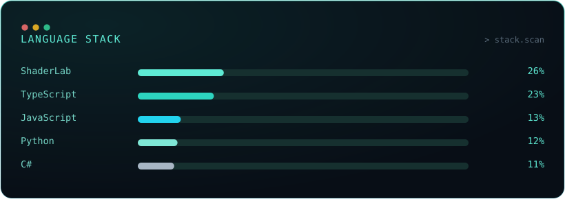
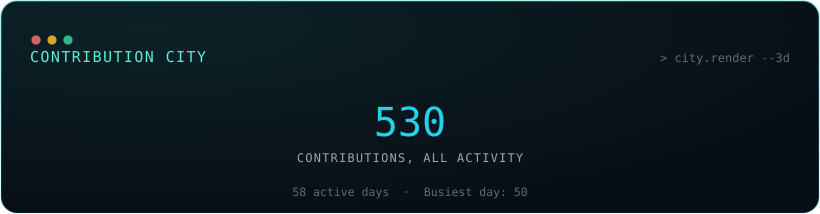
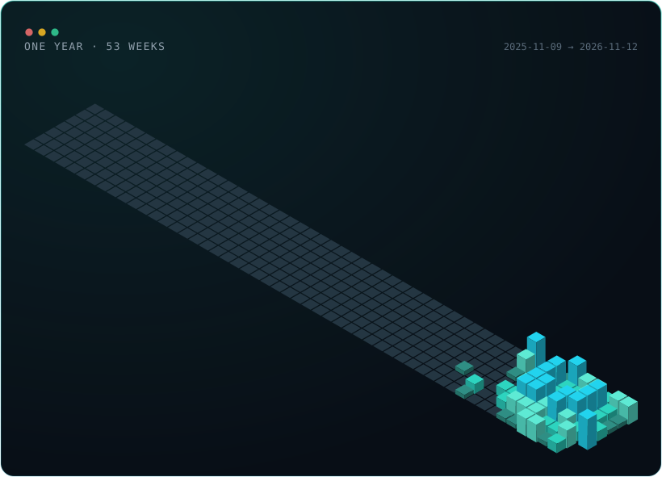
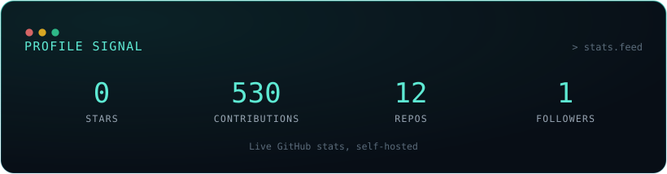
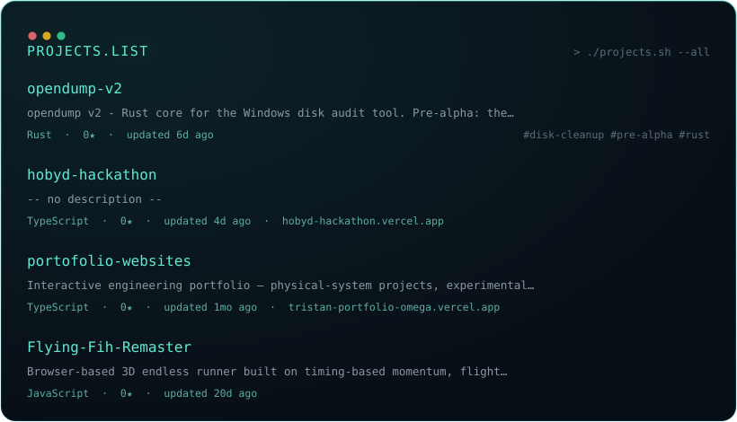
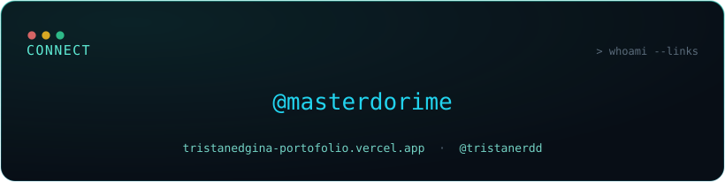

<h1 align="center">TRISTAN EDGINA</h1>

Computer Engineering Student · Telkom University

AI · Robotics · Embedded Systems · Game Dev &nbsp;·&nbsp; <strong>masih belajar</strong>

  

  

  

---

## TECH STACK

  

---

## LANGUAGE STACK

  

---

## CONTRIBUTION CITY

  

  

Every building is a day. Taller means more contributions.

---

## BY THE NUMBERS

  

---

## SELECTED WORK

  

<table>
<tr>
<td width="50%" valign="top">

**01 · [opendump-v2](https://github.com/masterdorime/opendump-v2)**

The Rust core of a Windows disk audit tool. Pre-alpha: the classifier is ported and tested; scanner, executor and Tauri shell are next.

`Rust` `Tauri` `Windows` `Pre-alpha`

**02 · [HOBYD — Live Auction](https://github.com/masterdorime/hobyd-hackathon)**

A live auction marketplace for collectors: sellers stream, buyers bid in real time. Built for CR Youth 2026 Hackathon with Tim Pekalongan Hemker Community.

`Next.js` `TypeScript` `Supabase` `LiveKit`

[Live Demo →](https://hobyd-hackathon.vercel.app)

</td>
<td width="50%" valign="top">

**03 · [Personal Engineering Portfolio](https://github.com/masterdorime/portofolio-websites)**

An interactive engineering portfolio: physical-system projects, experimental interfaces, interactive 3D graphics, motion and technical storytelling.

`Next.js` `React` `TypeScript` `Three.js` `Tailwind`

[Live Portfolio →](https://tristan-portfolio-omega.vercel.app/)

**04 · [Flying Fish Momentum](https://github.com/masterdorime/Flying-Fih-Remaster)**

A browser-based 3D endless runner built on timing-based momentum, flight progression and procedural gameplay systems, with adaptive music.

`JavaScript` `Three.js` `Web Audio API`

</td>
</tr>
</table>

---

## STREAK

 

---

## FIND ME

  

  <a href="https://tristanedgina-portofolio.vercel.app">Portfolio</a> ·
  <a href="https://hobyd-prototype.vercel.app">HOBYD</a> ·
  <a href="https://x.com/tristanerdd">X</a> ·
  <a href="https://www.instagram.com/tristanerdd/">Instagram</a> ·
  <a href="https://www.threads.com/tristanerdd/">Threads</a>

 

ENGINEERED WITH CURIOSITY. BUILT WITH PURPOSE.

