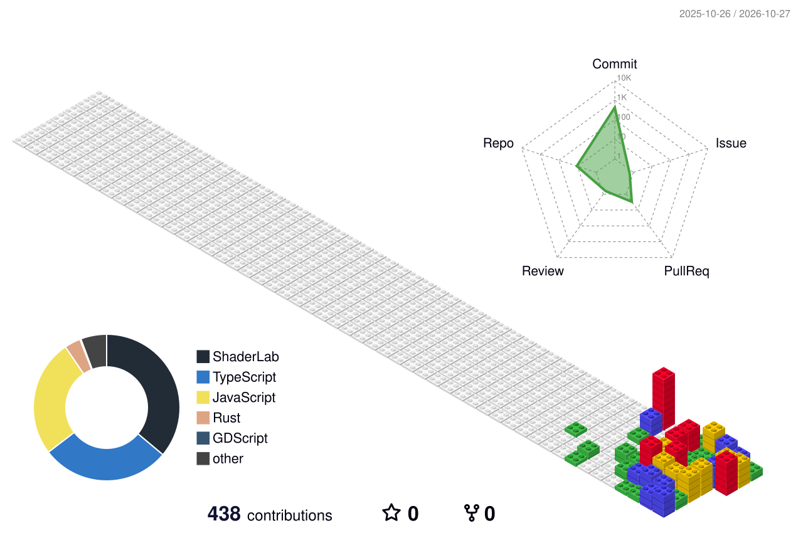

<h1 align="center">TRISTAN EDGINA</h1>

Computer Engineering Student · Telkom University

AI · Robotics · Embedded Systems · Game Dev &nbsp;·&nbsp; <strong>masih belajar</strong>

  

  

---

## TECH STACK

  

---

## LANGUAGE STACK

  

---

## CONTRIBUTION CITY

  

Every building is a day. Taller means more contributions.

Self-hosted view · needs no external service

  

---

## BY THE NUMBERS

  

---

## SELECTED WORK

  

<table>
<tr>
<td width="50%" valign="top">

**01 · [Personal Engineering Portfolio](https://github.com/masterdorime/portofolio-websites)**

An interactive engineering portfolio: physical-system projects, experimental interfaces, interactive 3D graphics, motion and technical storytelling.

`Next.js` `React` `TypeScript` `Three.js` `Tailwind`

[Live Portfolio →](https://tristan-portfolio-omega.vercel.app/)

**02 · [HOBYD — Live Auction Marketplace](https://github.com/masterdorime/hobyd-prototype)**

A mobile-first marketplace for collectors: real-time auctions, live video, community chat, bidding and checkout. First target market is Pokémon TCG.

`Next.js` `React` `TypeScript` `Supabase` `LiveKit`

[Live Prototype →](https://hobyd-prototype.vercel.app/)

</td>
<td width="50%" valign="top">

**03 · [Flying Fish Momentum](https://github.com/masterdorime/Flying-Fih-Remaster)**

A browser-based 3D endless runner built on timing-based momentum, flight progression and procedural gameplay systems, with adaptive music.

`JavaScript` `Three.js` `Web Audio API`

**04 · [Aim Drill 3D](https://github.com/masterdorime/aim-drill-game-nyahu)**

A browser-playable 3D aim trainer: six training scenarios, customizable drills, performance analysis, scenario ranks and local leaderboards.

`Godot` `GDScript` `Web Export`

[Play Online →](https://masterdorime.github.io/aim-drill-game-nyahu/)

**05 · [Penghitung Traffic YOLO](https://github.com/masterdorime/penghitung-traffic-yolo)**

A local vehicle-counting system for CCTV footage using YOLO detection and vehicle tracking, with calibrated counting lines, traffic-period reports, a dashboard and CSV export.

`Python` `YOLO` `Computer Vision`

</td>
</tr>
</table>

---

## CONTRIBUTION RHYTHM

  

---

## FIND ME

  

  <a href="https://tristanedgina-portofolio.vercel.app">Portfolio</a> ·
  <a href="https://hobyd-prototype.vercel.app">HOBYD</a> ·
  <a href="https://x.com/tristanerdd">X</a> ·
  <a href="https://www.instagram.com/tristanerdd/">Instagram</a> ·
  <a href="https://www.threads.com/tristanerdd/">Threads</a>

 

ENGINEERED WITH CURIOSITY. BUILT WITH PURPOSE.

